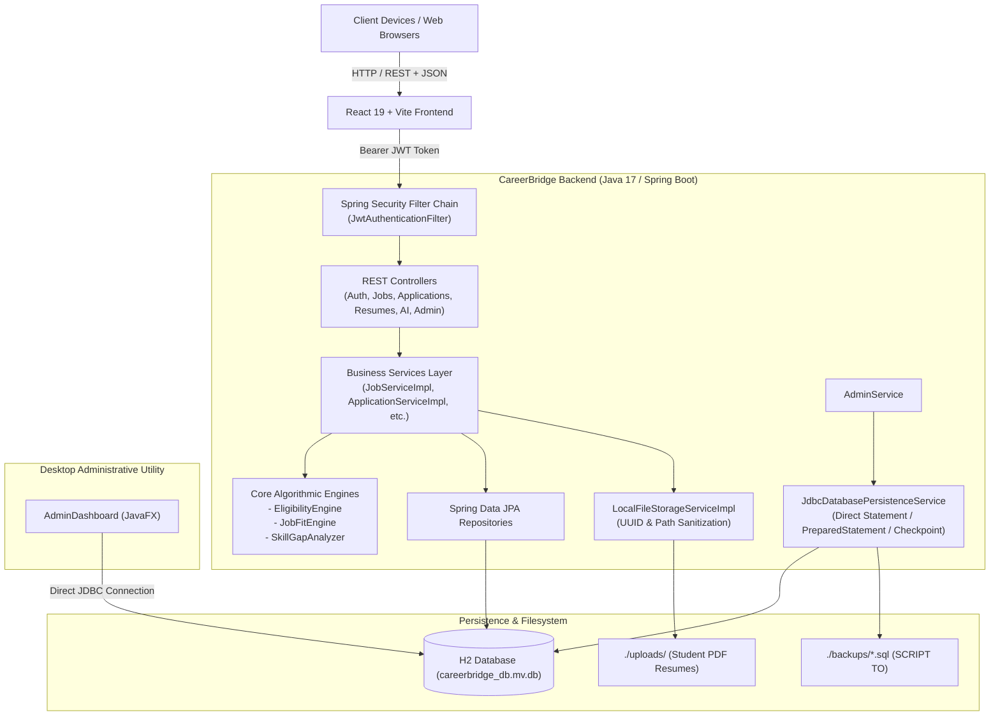
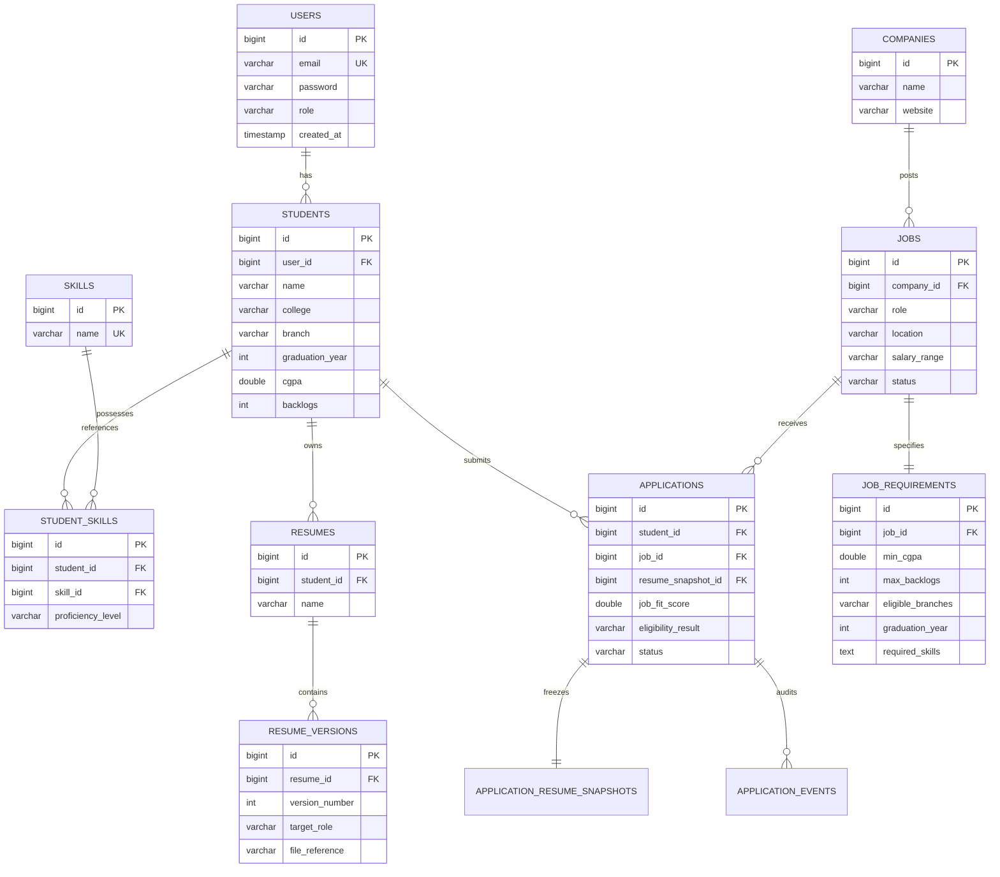

# CareerBridge: Project Review & Java Code Walkthrough Manual

> **Official Project Presentation & Viva Defense Guide**  
> **Project Title:** CareerBridge – Smart Campus Placement & Automated Career Intelligence Portal  
> **Technology Stack:** Java 17 | Spring Boot | Spring Data JPA | Spring Security (JWT) | JavaFX (JDBC) | H2 Database | React & Vite  

---

## Table of Contents
1. [Project Overview & Key Objectives](#1-project-overview--key-objectives)
2. [End-to-End System Architecture](#2-end-to-end-system-architecture)
3. [Project Directory & Package Alignment](#3-project-directory--package-alignment)
4. [Deep-Dive Java Code Walkthrough & Defense Scripts](#4-deep-dive-java-code-walkthrough--defense-scripts)
   - [4.1 Security & Authentication Layer](#41-security--authentication-layer)
   - [4.2 Decision Engines (Eligibility, Job Fit & Skill Gap)](#42-decision-engines-eligibility-job-fit--skill-gap)
   - [4.3 Service Implementation & Business Logic Layer](#43-service-implementation--business-logic-layer)
   - [4.4 REST Controllers Layer](#44-rest-controllers-layer)
   - [4.5 Domain Entities & Immutable Snapshot Model](#45-domain-entities--immutable-snapshot-model)
   - [4.6 Direct JDBC & JavaFX Desktop Management Tool](#46-direct-jdbc--javafx-desktop-management-tool)
5. [Database Schema & Entity Relationships (ER Diagram)](#5-database-schema--entity-relationships-er-diagram)
6. [Complete REST API Reference](#6-complete-rest-api-reference)
7. [Step-by-Step Live Demo Execution Guide](#7-step-by-step-live-demo-execution-guide)
8. [Top 20 Reviewer Viva Questions & Model Answers](#8-top-20-reviewer-viva-questions--model-answers)

---

## 1. Project Overview & Key Objectives

Traditional college placement drives rely on manual spreadsheets, fragmented email chains, and disconnected resume files. This leads to human error in eligibility filtering, lost resume versions, lack of visibility for students, and heavy administrative overhead for placement officers and recruiters.

**CareerBridge** is an enterprise-grade campus placement and career intelligence portal engineered using Java 17 and Spring Boot. It provides:
1. **Automated Eligibility Engine:** Instant, deterministic verification of student academic requirements (CGPA cutoff, maximum active backlogs, graduation batch, eligible branches).
2. **Multi-Criteria Job Fit Engine:** Weighted scoring model (0–100%) factoring in technical skill match, CGPA score, project depth, experience compatibility, and domain keywords.
3. **Skill Gap Analyzer:** Automatic intersection and difference between student competencies and employer prerequisites, providing personalized learning recommendations.
4. **Resume Versioning & Immutable Snapshots:** Allows students to tailor resumes per job domain while capturing an immutable audit snapshot (`ApplicationResumeSnapshot`) when applying, ensuring historical accuracy.
5. **One-Click Auto-Apply Pipeline:** Batch evaluates candidate eligibility across open roles and submits applications automatically.
6. **Dual Persistence Model:** Modern Spring Data JPA / Hibernate ORM paired with a direct JDBC persistence management service and JavaFX desktop administrative dashboard.

---

## 2. End-to-End System Architecture



---

## 3. Project Directory & Package Alignment

The Java source code is strictly structured under `src/main/java/com/careerbridge/` according to standard enterprise clean architecture:

| Package / Directory | Primary Responsibility | Key Files |
| :--- | :--- | :--- |
| `com.careerbridge` | Application bootstrap, seeder & desktop launcher | [CareerbridgeApplication.java](file:///Users/sharangoshreddy/.gemini/antigravity-ide/scratch/careerbridge/src/main/java/com/careerbridge/CareerbridgeApplication.java), [DataSeeder.java](file:///Users/sharangoshreddy/.gemini/antigravity-ide/scratch/careerbridge/src/main/java/com/careerbridge/DataSeeder.java), [Launcher.java](file:///Users/sharangoshreddy/.gemini/antigravity-ide/scratch/careerbridge/src/main/java/com/careerbridge/Launcher.java), [AdminDashboard.java](file:///Users/sharangoshreddy/.gemini/antigravity-ide/scratch/careerbridge/src/main/java/com/careerbridge/AdminDashboard.java) |
| `config` | Spring application & security filter chain definitions | [SecurityConfig.java](file:///Users/sharangoshreddy/.gemini/antigravity-ide/scratch/careerbridge/src/main/java/com/careerbridge/config/SecurityConfig.java) |
| `security` | JWT token generator, filter, entry point & user details | [JwtTokenProvider.java](file:///Users/sharangoshreddy/.gemini/antigravity-ide/scratch/careerbridge/src/main/java/com/careerbridge/security/JwtTokenProvider.java), [JwtAuthenticationFilter.java](file:///Users/sharangoshreddy/.gemini/antigravity-ide/scratch/careerbridge/src/main/java/com/careerbridge/security/JwtAuthenticationFilter.java), [CustomUserDetailsService.java](file:///Users/sharangoshreddy/.gemini/antigravity-ide/scratch/careerbridge/src/main/java/com/careerbridge/security/CustomUserDetailsService.java), [JwtAuthenticationEntryPoint.java](file:///Users/sharangoshreddy/.gemini/antigravity-ide/scratch/careerbridge/src/main/java/com/careerbridge/security/JwtAuthenticationEntryPoint.java) |
| `service.engine` | Core domain algorithms (eligibility, fit, skill gap) | [EligibilityEngine.java](file:///Users/sharangoshreddy/.gemini/antigravity-ide/scratch/careerbridge/src/main/java/com/careerbridge/service/engine/EligibilityEngine.java), [JobFitEngine.java](file:///Users/sharangoshreddy/.gemini/antigravity-ide/scratch/careerbridge/src/main/java/com/careerbridge/service/engine/JobFitEngine.java), [SkillGapAnalyzer.java](file:///Users/sharangoshreddy/.gemini/antigravity-ide/scratch/careerbridge/src/main/java/com/careerbridge/service/engine/SkillGapAnalyzer.java) |
| `service` | Service interface declarations & utility services | [JobService.java](file:///Users/sharangoshreddy/.gemini/antigravity-ide/scratch/careerbridge/src/main/java/com/careerbridge/service/JobService.java), [ApplicationService.java](file:///Users/sharangoshreddy/.gemini/antigravity-ide/scratch/careerbridge/src/main/java/com/careerbridge/service/ApplicationService.java), [ResumeService.java](file:///Users/sharangoshreddy/.gemini/antigravity-ide/scratch/careerbridge/src/main/java/com/careerbridge/service/ResumeService.java), [AIService.java](file:///Users/sharangoshreddy/.gemini/antigravity-ide/scratch/careerbridge/src/main/java/com/careerbridge/service/AIService.java), [AutoApplyService.java](file:///Users/sharangoshreddy/.gemini/antigravity-ide/scratch/careerbridge/src/main/java/com/careerbridge/service/AutoApplyService.java), [JdbcDatabasePersistenceService.java](file:///Users/sharangoshreddy/.gemini/antigravity-ide/scratch/careerbridge/src/main/java/com/careerbridge/service/JdbcDatabasePersistenceService.java) |
| `service.impl` | Business logic implementations with transaction management | [JobServiceImpl.java](file:///Users/sharangoshreddy/.gemini/antigravity-ide/scratch/careerbridge/src/main/java/com/careerbridge/service/impl/JobServiceImpl.java), [ApplicationServiceImpl.java](file:///Users/sharangoshreddy/.gemini/antigravity-ide/scratch/careerbridge/src/main/java/com/careerbridge/service/impl/ApplicationServiceImpl.java), [ResumeServiceImpl.java](file:///Users/sharangoshreddy/.gemini/antigravity-ide/scratch/careerbridge/src/main/java/com/careerbridge/service/impl/ResumeServiceImpl.java), [LocalFileStorageServiceImpl.java](file:///Users/sharangoshreddy/.gemini/antigravity-ide/scratch/careerbridge/src/main/java/com/careerbridge/service/impl/LocalFileStorageServiceImpl.java) |
| `controller` | REST API HTTP request endpoints and response mapping | [AuthController.java](file:///Users/sharangoshreddy/.gemini/antigravity-ide/scratch/careerbridge/src/main/java/com/careerbridge/controller/AuthController.java), [JobController.java](file:///Users/sharangoshreddy/.gemini/antigravity-ide/scratch/careerbridge/src/main/java/com/careerbridge/controller/JobController.java), [ApplicationController.java](file:///Users/sharangoshreddy/.gemini/antigravity-ide/scratch/careerbridge/src/main/java/com/careerbridge/controller/ApplicationController.java), [ResumeController.java](file:///Users/sharangoshreddy/.gemini/antigravity-ide/scratch/careerbridge/src/main/java/com/careerbridge/controller/ResumeController.java), [AdminController.java](file:///Users/sharangoshreddy/.gemini/antigravity-ide/scratch/careerbridge/src/main/java/com/careerbridge/controller/AdminController.java) |
| `entity` | JPA Relational Entities mapped to H2 SQL database | [User.java](file:///Users/sharangoshreddy/.gemini/antigravity-ide/scratch/careerbridge/src/main/java/com/careerbridge/entity/User.java), [Student.java](file:///Users/sharangoshreddy/.gemini/antigravity-ide/scratch/careerbridge/src/main/java/com/careerbridge/entity/Student.java), [Job.java](file:///Users/sharangoshreddy/.gemini/antigravity-ide/scratch/careerbridge/src/main/java/com/careerbridge/entity/Job.java), [JobRequirement.java](file:///Users/sharangoshreddy/.gemini/antigravity-ide/scratch/careerbridge/src/main/java/com/careerbridge/entity/JobRequirement.java), [Application.java](file:///Users/sharangoshreddy/.gemini/antigravity-ide/scratch/careerbridge/src/main/java/com/careerbridge/entity/Application.java), [ApplicationResumeSnapshot.java](file:///Users/sharangoshreddy/.gemini/antigravity-ide/scratch/careerbridge/src/main/java/com/careerbridge/entity/ApplicationResumeSnapshot.java) |
| `repository` | Spring Data JPA interfaces extending `JpaRepository` | [JobRepository.java](file:///Users/sharangoshreddy/.gemini/antigravity-ide/scratch/careerbridge/src/main/java/com/careerbridge/repository/JobRepository.java), [ApplicationRepository.java](file:///Users/sharangoshreddy/.gemini/antigravity-ide/scratch/careerbridge/src/main/java/com/careerbridge/repository/ApplicationRepository.java), [UserRepository.java](file:///Users/sharangoshreddy/.gemini/antigravity-ide/scratch/careerbridge/src/main/java/com/careerbridge/repository/UserRepository.java), etc. |
| `dto` | Data Transfer Objects for client requests & responses | `dto.request.*`, `dto.response.*` |
| `exception` | Centralized `@ControllerAdvice` error interceptor | [GlobalExceptionHandler.java](file:///Users/sharangoshreddy/.gemini/antigravity-ide/scratch/careerbridge/src/main/java/com/careerbridge/exception/GlobalExceptionHandler.java) |

---

## 4. Deep-Dive Java Code Walkthrough & Defense Scripts

Use the following breakdown during your review. For each file, the review script tells you exactly what to say to the panel when displaying the file.

---

### 4.1 Security & Authentication Layer

#### 1. [SecurityConfig.java](file:///Users/sharangoshreddy/.gemini/antigravity-ide/scratch/careerbridge/src/main/java/com/careerbridge/config/SecurityConfig.java)
- **What it does:** Configures the Spring Security filter chain. Enforces stateless session management (`SessionCreationPolicy.STATELESS`), disables CSRF (since requests use JWT Bearer tokens), sets up CORS headers, and registers `JwtAuthenticationFilter` before `UsernamePasswordAuthenticationFilter`.
- **Reviewer Speaking Script:**
  > *"Sir/Ma'am, in `SecurityConfig.java`, we implemented a stateless security model adhering to modern REST architecture. Instead of maintaining server-side HTTP sessions, the application generates a cryptographically signed JSON Web Token upon login. Every subsequent request passes through our custom `JwtAuthenticationFilter` which validates the signature before reaching our controllers."*
- **Key Code Snippet to Show:**
  ```java
  http.csrf(AbstractHttpConfigurer::disable)
      .sessionManagement(session -> session.sessionCreationPolicy(SessionCreationPolicy.STATELESS))
      .authorizeHttpRequests(auth -> auth
          .requestMatchers("/api/auth/**", "/index.html", "/", "/assets/**").permitAll()
          .anyRequest().authenticated()
      );
  http.addFilterBefore(jwtAuthenticationFilter(), UsernamePasswordAuthenticationFilter.class);
  ```

#### 2. [JwtTokenProvider.java](file:///Users/sharangoshreddy/.gemini/antigravity-ide/scratch/careerbridge/src/main/java/com/careerbridge/security/JwtTokenProvider.java)
- **What it does:** Generates, parses, and cryptographically verifies JWT tokens using the HMAC-SHA256 (`HS256`) signing key. Encodes user email as subject and assigned user role as a custom claim.
- **Reviewer Speaking Script:**
  > *"This component is responsible for the lifecycle of authentication tokens. In `generateToken()`, we bind the user's email, issuance timestamp, expiration duration, and security role. The method `validateToken()` uses JJWT's parser builder to ensure tokens haven't expired or been tampered with."*

#### 3. [JwtAuthenticationFilter.java](file:///Users/sharangoshreddy/.gemini/antigravity-ide/scratch/careerbridge/src/main/java/com/careerbridge/security/JwtAuthenticationFilter.java)
- **What it does:** Extends `OncePerRequestFilter`. Extracts the `Bearer <token>` from the HTTP `Authorization` header, validates it, fetches `UserDetails`, and populates Spring's `SecurityContextHolder`.

---

### 4.2 Decision Engines (Eligibility, Job Fit & Skill Gap)

#### 1. [EligibilityEngine.java](file:///Users/sharangoshreddy/.gemini/antigravity-ide/scratch/careerbridge/src/main/java/com/careerbridge/service/engine/EligibilityEngine.java)
- **What it does:** Performs deterministic rule checking against candidate academic criteria:
  1. `student.cgpa >= req.minCgpa`
  2. `student.backlogs <= req.maxBacklogs`
  3. `student.graduationYear == req.graduationYear`
  4. `req.eligibleBranches.contains(student.branch)`
- **Reviewer Speaking Script:**
  > *"Here in `EligibilityEngine.java`, we evaluate candidate eligibility through a deterministic rule check. Instead of returning a simple boolean, it constructs an `EligibilityResult` with detailed audit reasons for each rule. This explains to students why they were rejected or permitted to apply."*
- **Key Code Snippet to Show:**
  ```java
  if (req.getMinCgpa() != null && student.getCgpa() != null) {
      if (student.getCgpa() < req.getMinCgpa()) {
          eligible = false;
          result.reasons.add("CGPA requirement not met. Required: " + req.getMinCgpa() + "+, Student: " + student.getCgpa());
      } else {
          result.reasons.add("CGPA requirement met.");
      }
  }
  ```

#### 2. [JobFitEngine.java](file:///Users/sharangoshreddy/.gemini/antigravity-ide/scratch/careerbridge/src/main/java/com/careerbridge/service/engine/JobFitEngine.java)
- **What it does:** Calculates a weighted composite match percentage (0%–100%) between a candidate's profile and a job posting:
  - **40%:** Technical skills match ratio (required skills vs student skills)
  - **20%:** Academic performance (normalized CGPA on 100-point scale)
  - **15%:** Project depth and skill proficiency levels (ADVANCED vs INTERMEDIATE)
  - **15%:** Experience suitability
  - **10%:** Branch and target role keyword alignment
- **Reviewer Speaking Script:**
  > *"In `JobFitEngine.java`, we implemented a multi-criteria scoring algorithm. Rather than relying on naive text matching, we compute individual sub-scores for technical skills, academics, projects, and domain keywords, weighting them into an overall compatibility percentage."*

#### 3. [SkillGapAnalyzer.java](file:///Users/sharangoshreddy/.gemini/antigravity-ide/scratch/careerbridge/src/main/java/com/careerbridge/service/engine/SkillGapAnalyzer.java)
- **What it does:** Performs mathematical set intersection ($StudentSkills \cap RequiredSkills$) and set difference ($RequiredSkills \setminus StudentSkills$) to find missing skills and generate recommendations.
- **Reviewer Speaking Script:**
  > *"The `SkillGapAnalyzer` empowers students with actionable feedback. By identifying which required skills are missing from their profile, it generates actionable learning suggestions so they can upskill before placements."*

---

### 4.3 Service Implementation & Business Logic Layer

#### 1. [ApplicationServiceImpl.java](file:///Users/sharangoshreddy/.gemini/antigravity-ide/scratch/careerbridge/src/main/java/com/careerbridge/service/impl/ApplicationServiceImpl.java)
- **What it does:** Orchestrates the job application lifecycle:
  1. Validates that the student owns the selected resume version.
  2. Creates an immutable `ApplicationResumeSnapshot`.
  3. Computes and records real-time eligibility and job fit scores.
  4. Saves the `Application` and generates an `ApplicationEvent` for timeline auditing.
  5. Implements status progression (`APPLIED`, `SHORTLISTED`, `INTERVIEW_SCHEDULED`, `OFFERED`, `REJECTED`).
- **Reviewer Speaking Script:**
  > *"In `ApplicationServiceImpl.java`, notice the transactional integrity in `submitApplication()`. When a student applies, we compute an immutable resume snapshot with a content hash and store an audit event in the application timeline. Even if the student subsequently alters their resume, the recruiter's copy remains untouched."*

#### 2. [ResumeServiceImpl.java](file:///Users/sharangoshreddy/.gemini/antigravity-ide/scratch/careerbridge/src/main/java/com/careerbridge/service/impl/ResumeServiceImpl.java)
- **What it does:** Handles multi-version resume management:
  - Supports multiple tailored resumes (e.g., "Full-Stack Developer", "Data Scientist").
  - Auto-increments version numbers (`v1`, `v2`, `v3`).
  - Delegates PDF binary storage to `LocalFileStorageServiceImpl`.

#### 3. [AutoApplyService.java](file:///Users/sharangoshreddy/.gemini/antigravity-ide/scratch/careerbridge/src/main/java/com/careerbridge/service/AutoApplyService.java)
- **What it does:** Iterates through all open jobs, checks candidate eligibility using `EligibilityEngine`, and automatically applies on behalf of the student using their default resume version.

#### 4. [AIService.java](file:///Users/sharangoshreddy/.gemini/antigravity-ide/scratch/careerbridge/src/main/java/com/careerbridge/service/AIService.java)
- **What it does:** Generates intelligent resume critique (strengths, weaknesses, ATS suggestions), produces role-tailored technical & behavioral interview questions, and synthesizes personalized cover letters.

---

### 4.4 REST Controllers Layer

All controllers reside in `com.careerbridge.controller` and follow REST conventions:

| Controller | Base Path | Key Endpoints & Functionality |
| :--- | :--- | :--- |
| [AuthController.java](file:///Users/sharangoshreddy/.gemini/antigravity-ide/scratch/careerbridge/src/main/java/com/careerbridge/controller/AuthController.java) | `/api/auth` | `POST /login` (authenticates and returns JWT token), `POST /register` (creates user & student profile) |
| [JobController.java](file:///Users/sharangoshreddy/.gemini/antigravity-ide/scratch/careerbridge/src/main/java/com/careerbridge/controller/JobController.java) | `/api/jobs` | `GET /` (list jobs), `POST /` (recruiter job creation), `POST /{id}/eligibility-check`, `POST /{id}/jobfit`, `POST /{id}/skill-gap` |
| [ApplicationController.java](file:///Users/sharangoshreddy/.gemini/antigravity-ide/scratch/careerbridge/src/main/java/com/careerbridge/controller/ApplicationController.java) | `/api/applications` | `POST /` (submit application), `GET /my` (student apps), `GET /job/{jobId}` (recruiter apps), `PUT /{id}/status` (status update), `GET /{id}/timeline` |
| [ResumeController.java](file:///Users/sharangoshreddy/.gemini/antigravity-ide/scratch/careerbridge/src/main/java/com/careerbridge/controller/ResumeController.java) | `/api/resumes` | `POST /` (create resume profile), `POST /{id}/versions` (upload new PDF version), `GET /versions/{versionId}/download` (download PDF) |
| [StudentController.java](file:///Users/sharangoshreddy/.gemini/antigravity-ide/scratch/careerbridge/src/main/java/com/careerbridge/controller/StudentController.java) | `/api/students/profile` | `GET /` (fetch profile), `PUT /` (update CGPA, branch, backlogs, contact details) |
| [AIController.java](file:///Users/sharangoshreddy/.gemini/antigravity-ide/scratch/careerbridge/src/main/java/com/careerbridge/controller/AIController.java) | `/api/ai` | `GET /resume/{id}/analyze` (ATS critique), `GET /job/{id}/interview-prep` (interview questions), `POST /cover-letter` (generate cover letter) |
| [AdminController.java](file:///Users/sharangoshreddy/.gemini/antigravity-ide/scratch/careerbridge/src/main/java/com/careerbridge/controller/AdminController.java) | `/api/admin` | `GET /dashboard` (stats), `GET /database/status` (JDBC metadata), `POST /database/checkpoint` (flush to disk), `POST /database/backup` (generate SQL dump) |

---

### 4.5 Domain Entities & Immutable Snapshot Model

#### [ApplicationResumeSnapshot.java](file:///Users/sharangoshreddy/.gemini/antigravity-ide/scratch/careerbridge/src/main/java/com/careerbridge/entity/ApplicationResumeSnapshot.java)
- **Why it is crucial for review:**
  > *"In typical placement portals, if a student uploads an updated resume, their previous job applications silently link to the new file. This creates legal and compliance issues if a recruiter shortlisted the candidate based on an earlier version. To solve this, we implemented the **Immutable Snapshot Pattern**. At application submission, we freeze the resume name, version number, disk path, and hash in `ApplicationResumeSnapshot`."*

```java
@Entity
@Table(name = "application_resume_snapshots")
public class ApplicationResumeSnapshot {
    @Id
    @GeneratedValue(strategy = GenerationType.IDENTITY)
    private Long id;

    private String resumeName;
    private Integer resumeVersion;
    private Long resumeVersionId;
    private String fileReference;
    private String contentHash;

    @CreationTimestamp
    private LocalDateTime submissionTimestamp;
}
```

---

### 4.6 Direct JDBC & JavaFX Desktop Management Tool

#### 1. [JdbcDatabasePersistenceService.java](file:///Users/sharangoshreddy/.gemini/antigravity-ide/scratch/careerbridge/src/main/java/com/careerbridge/service/JdbcDatabasePersistenceService.java)
- Demonstrates advanced JDBC skills required in Java curriculum evaluations:
  - `DatabaseMetaData`: Inspects tables, driver details, and row counts dynamically.
  - `CHECKPOINT SYNC`: Forces database buffer cache to synchronize to physical storage.
  - `SCRIPT TO './backups/*.sql'`: Executes raw SQL database dumps.

#### 2. [AdminDashboard.java](file:///Users/sharangoshreddy/.gemini/antigravity-ide/scratch/careerbridge/src/main/java/com/careerbridge/AdminDashboard.java)
- Standalone JavaFX desktop client that connects directly to the database via `DriverManager.getConnection()`.
- Demonstrates `PreparedStatement` parameterized inserts and `Statement` querying into an interactive `TableView`.

---

## 5. Database Schema & Entity Relationships (ER Diagram)



---

## 6. Complete REST API Reference

| Endpoint | Method | Role Allowed | Description | Sample Request Body / Param |
| :--- | :---: | :--- | :--- | :--- |
| `/api/auth/register` | `POST` | Public | Register new Student or Recruiter account | `{"email": "...", "password": "...", "role": "STUDENT", "name": "..."}` |
| `/api/auth/login` | `POST` | Public | Authenticate user and receive Bearer JWT | `{"email": "student@careerbridge.com", "password": "password123"}` |
| `/api/jobs` | `GET` | Authenticated | List all active job postings with requirements | None |
| `/api/jobs` | `POST` | Recruiter / Admin | Create a new job vacancy with criteria | `{"role": "Backend Dev", "location": "Remote", "salaryRange": "₹18 LPA", ...}` |
| `/api/jobs/{id}/eligibility-check`| `POST` | Student | Evaluate student academic criteria for job | None |
| `/api/jobs/{id}/jobfit` | `POST` | Student | Compute weighted composite job fit score | None |
| `/api/jobs/{id}/skill-gap` | `POST` | Student | Analyze matched & missing skills | None |
| `/api/resumes` | `POST` | Student | Create a new tailored resume container | `name="Software Engineer"` |
| `/api/resumes/{id}/versions` | `POST` | Student | Upload a new PDF version for a resume | `MultipartFile file, targetRole, skillsRepresented` |
| `/api/resumes/versions/{vId}/download`| `GET` | Student | Securely stream the uploaded PDF resume | Path variable `vId` |
| `/api/applications` | `POST` | Student | Apply to job with immutable resume snapshot | `{"jobId": 1, "resumeVersionId": 1}` |
| `/api/applications/my` | `GET` | Student | View all jobs applied to by student | None |
| `/api/applications/job/{jobId}` | `GET` | Recruiter | View candidate submissions for a posting | Path variable `jobId` |
| `/api/applications/{id}/status` | `PUT` | Recruiter / Admin | Update application status (`INTERVIEW_SCHEDULED`) | `newStatus="SHORTLISTED"` |
| `/api/applications/{id}/timeline` | `GET` | Authenticated | Fetch audit history of events for an application | Path variable `id` |
| `/api/auto-apply/run` | `POST` | Student | Batch auto-apply to all eligible jobs | `defaultResumeVersionId=1` |
| `/api/ai/resume/{vId}/analyze` | `GET` | Student | Run ATS critique and recommendations | Path variable `vId` |
| `/api/ai/job/{id}/interview-prep` | `GET` | Student | Generate role-specific interview questions | Path variable `id` |
| `/api/ai/cover-letter` | `POST` | Student | Synthesize personalized cover letter | `{"jobDescription": "...", "targetRole": "..."}` |
| `/api/admin/dashboard` | `GET` | Admin | Fetch system-wide placement analytics | None |
| `/api/admin/database/backup` | `POST` | Admin | Trigger live JDBC SQL database backup dump | `note="pre_review"` |

---

## 7. Step-by-Step Live Demo Execution Guide

Follow these steps to demonstrate the application to your evaluators:

### Pre-Configured Test Credentials
- **Student Persona:** `student@careerbridge.com` / `password123`
- **Recruiter Persona:** `recruiter@careerbridge.com` / `password123`
- **Admin Persona:** `admin@careerbridge.com` / `password123`

### Step 1: Launch Backend Server
In a terminal, run:
```bash
./mvnw spring-boot:run
```
*(Backend boots up on `http://localhost:8080`, initializes the embedded H2 database, and executes `DataSeeder.java` to inject mock users, companies, jobs, and applications).*

### Step 2: Launch Frontend Development Server
In a second terminal, run:
```bash
cd frontend
npm run dev
```
*(Frontend starts on `http://localhost:5173`).*

### Step 3: Demonstrate Student Workflow
1. Navigate to `http://localhost:5173` and click **Login**.
2. Log in as `student@careerbridge.com` with password `password123`.
3. **Profile Verification:** Show student CGPA (8.8), branch (Computer Science), and verified skills.
4. **Resume Management:** Open the **Resumes** tab. Demonstrate the uploaded PDF resume version. Click **ATS Review** to show instant AI critique.
5. **Job Discovery & Matching:** Open the **Jobs** tab.
   - Click **Check Eligibility** on Google Software Engineer: Show green badge (`ELIGIBLE`) and criteria audit.
   - Click **Analyze Match / Job Fit**: Show the 88% overall compatibility score breakdown.
   - Click **Skill Gap**: Highlight matched skills vs missing skills with learning recommendations.
6. **Submit Application:** Click **Apply**. Select the resume version. Show that the submission succeeded and an immutable snapshot was created.
7. **Demonstrate Auto-Apply:** Click the **Auto-Apply** button. The system evaluates all open postings and applies to every eligible position automatically.

### Step 4: Demonstrate Recruiter Workflow
1. Log out and log in as `recruiter@careerbridge.com` with password `password123`.
2. Open the **Recruiter Dashboard**.
3. View the list of applicants for the Google posting.
4. Click on student `Alex Chen`. Show their compatibility score and view their submitted resume.
5. Change the status from `UNDER_REVIEW` to `INTERVIEW_SCHEDULED`. Show the audit event generated in the application timeline.

### Step 5: Demonstrate Admin & JDBC Persistence Tool
1. In the web portal, log in as `admin@careerbridge.com`. Show system analytics and database status.
2. In your terminal, run the standalone JavaFX Administrative Desktop tool:
   ```bash
   ./mvnw javafx:run
   # OR run Launcher main class in VS Code / IDE
   ```
3. Show the desktop GUI displaying registered users via direct JDBC `Statement`.
4. Add a new user directly in the GUI using JDBC `PreparedStatement`.
5. Click **Save Database (JDBC Script)**: Show that the database checkpointed and saved an SQL dump to `./backups/`.

---

## 8. Top 20 Reviewer Viva Questions & Model Answers

### Q1: What architecture does this application follow?
**Answer:** It follows a 3-tier Layered Architecture consisting of a React Single-Page Application (Presentation Layer), a Spring Boot REST API (Application/Business Logic Layer), and Spring Data JPA + JDBC (Data Persistence Layer) backed by an H2 database.

### Q2: Why did you use JWT instead of standard HTTP sessions?
**Answer:** Standard HTTP sessions are stateful and require server-side memory storage, which restricts horizontal scalability across distributed nodes. JWT tokens are self-contained and cryptographically signed with HMAC-SHA256, allowing stateless verification on every request without requiring session synchronization.

### Q3: How do you handle password security?
**Answer:** Passwords are never stored in plaintext. In `SecurityConfig.java`, we configure a `BCryptPasswordEncoder` bean that applies a salted, slow hashing algorithm (BCrypt) before persisting credentials into the database.

### Q4: Explain the purpose of `ApplicationResumeSnapshot`.
**Answer:** In student portals, candidates frequently update their resumes. If job applications merely pointed by foreign key to `resumes`, past applications would reflect future changes. `ApplicationResumeSnapshot` captures an immutable snapshot of the resume version, file path, and content hash at the precise instant of submission.

### Q5: How does your Eligibility Engine work?
**Answer:** In `EligibilityEngine.java`, we evaluate candidate attributes (CGPA, active backlogs count, graduation year, branch) against company requirements. It returns an `EligibilityResult` with an audit trail of reasons, providing transparency for why a candidate is or isn't qualified.

### Q6: How does the Job Fit calculation differ from simple keyword matching?
**Answer:** `JobFitEngine.java` computes a weighted multi-criteria score factoring in:
- Technical skills match ratio (40%)
- Academic CGPA normalized to 100% (20%)
- Practical skill proficiency levels (15%)
- Experience requirement alignment (15%)
- Branch and domain keywords (10%)

### Q7: Why do you have direct JDBC code when you already have Spring Data JPA?
**Answer:** While Spring Data JPA is excellent for standard CRUD object-relational mapping, direct JDBC (demonstrated in `JdbcDatabasePersistenceService.java` and `AdminDashboard.java`) gives low-level database control:
1. Low-level schema inspection via `DatabaseMetaData`
2. Database checkpoint synchronization (`CHECKPOINT SYNC`)
3. Atomic physical SQL file backups (`SCRIPT TO`)
4. Demonstrating proficiency with `Connection`, `Statement`, and `PreparedStatement`.

### Q8: How do you prevent SQL Injection?
**Answer:** In Spring Data JPA, queries use parameterized queries under the hood. In our direct JDBC code (`AdminDashboard.java`), we strictly use `PreparedStatement` with placeholder parameters (`?`) rather than string concatenation.

### Q9: How do you prevent Path Traversal vulnerabilities in file uploads?
**Answer:** In `LocalFileStorageServiceImpl.java`, we sanitize filenames using `StringUtils.cleanPath()`, check for malicious path sequences like `..`, and rename uploaded files with random UUIDs (`student_{id}_{UUID}.pdf`), storing them outside the public web root.

### Q10: What is the role of `DataSeeder.java`?
**Answer:** It implements Spring Boot's `CommandLineRunner` interface. When the application context starts up, it automatically seeds default skills, companies, open job postings, student profiles, and demo users (Student, Recruiter, Admin), ensuring the application is ready for demonstration without manual data entry.

### Q11: What HTTP status codes are used across your REST APIs?
**Answer:**
- `200 OK`: Successful retrieval or update
- `201 CREATED`: Successful resource creation (user registration, resume upload, job application)
- `400 BAD REQUEST`: Validation errors or business rule failures (handled by `GlobalExceptionHandler`)
- `401 UNAUTHORIZED`: Invalid or missing JWT token (handled by `JwtAuthenticationEntryPoint`)
- `403 FORBIDDEN`: Insufficient role permissions (`@PreAuthorize("hasRole('ADMIN')")`)
- `404 NOT FOUND`: Entity or file reference not found

### Q12: How are exceptions handled globally?
**Answer:** We implemented `GlobalExceptionHandler.java` annotated with `@ControllerAdvice`. It intercepts `RuntimeException` and `MethodArgumentNotValidException`, returning clean JSON error responses instead of exposing stack traces.

### Q13: What cascade types are used in your JPA entities?
**Answer:** In `Application.java`, `@OneToOne(cascade = CascadeType.ALL)` is used for `resumeSnapshot`, ensuring that whenever an application is persisted, its immutable snapshot is automatically persisted with it.

### Q14: How does the Auto-Apply feature prevent invalid applications?
**Answer:** In `AutoApplyService.java`, before submitting any application, the service invokes `jobService.checkEligibility()`. If `eligibility.status != ELIGIBLE`, the job is skipped, preventing disqualified submissions.

### Q15: How does the application support role-based authorization?
**Answer:** User roles are modeled via the `Role` enum (`STUDENT`, `RECRUITER`, `ADMIN`). The role is encoded in the JWT claims and converted into a `GrantedAuthority` with prefix `ROLE_`. Methods and endpoints use `@PreAuthorize("hasRole('ADMIN')")` or `hasRole('RECRUITER')`.

### Q16: How is database persistence configured?
**Answer:** In `application.yml`, we configure an embedded H2 file database (`jdbc:h2:file:./careerbridge_db;AUTO_SERVER=TRUE`). The `AUTO_SERVER=TRUE` setting allows both the Spring Boot web application and the JavaFX desktop tool to connect concurrently to the same database file without locking conflicts.

### Q17: What design patterns did you use in this project?
**Answer:**
1. **Model-View-Controller (MVC):** Separation of data entities, controllers, and React UI.
2. **Repository Pattern:** Spring Data JPA repositories isolating data access logic.
3. **Data Transfer Object (DTO) Pattern:** Decoupling internal entity models from external API contracts.
4. **Strategy / Rule Engine Pattern:** Modular separation of `EligibilityEngine` and `JobFitEngine`.
5. **Immutable Snapshot Pattern:** Freezing application resume copies at submission time.
6. **Factory & Builder Patterns:** Lombok `@Builder` for clean entity and DTO instantiation.

### Q18: What is the purpose of `Launcher.java` alongside `AdminDashboard.java`?
**Answer:** In JavaFX 11+, launching an `Application` class directly from a standard main method without VM module arguments can throw an `UnsupportedOperationException`. Creating a standalone wrapper class `Launcher.java` that delegates to `AdminDashboard.main(args)` bypasses this limitation.

### Q19: How do you track the history of an application?
**Answer:** Each time an application changes state (applied, reviewed, interview scheduled, offered), an `ApplicationEvent` entity is created with an event type, description, and timestamp. The endpoint `/api/applications/{id}/timeline` returns this chronological audit trail.

### Q20: If this application were deployed to production with 10,000 students, what changes would you make?
**Answer:**
1. Switch from H2 to a production-grade relational database like PostgreSQL or MySQL (already supported via the provided `docker-compose.yml`).
2. Migrate local file storage (`LocalFileStorageServiceImpl`) to an S3-compatible cloud object store (AWS S3, Google Cloud Storage, or Azure Blob).
3. Introduce Redis for caching frequent job searches and token blacklisting upon logout.
4. Implement asynchronous messaging (RabbitMQ or Kafka) for email notifications and large batch auto-apply jobs.
